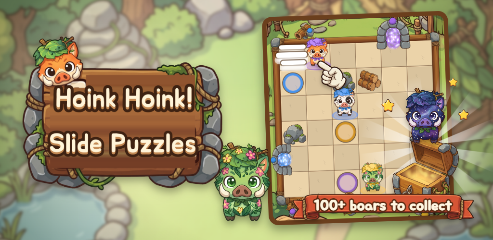

# Press kit: Hoink Hoink! Slide Puzzles

[한국어 요약](#한국어-요약) · [Home](./)

## Fact sheet

| | |
|---|---|
| **Title** | Hoink Hoink! Slide Puzzles (Korean: 맷꿀맷꿀! 슬라이드 퍼즐) |
| **Developer** | Hoink Studios (solo developer, South Korea) |
| **Platforms** | Android (Google Play), iOS and iPadOS (App Store) |
| **Release** | 2026, date to be announced. Android closed test first |
| **Price** | Free to play, optional in-app purchases, optional rewarded ads only |
| **Languages** | English, Korean, Russian, Portuguese (Brazil), Vietnamese |
| **Genre** | Cozy sliding puzzle and collection |
| **Website** | <https://seokyoo-dotcom.github.io/> |
| **Contact** | hoinkstudios@gmail.com |

## Short description

Push a boar and it slides until something stops it. Guide every boar to the gate of its colour, collect 100+ boars from free chests, and build ten cozy stone-age villages.

## About the game

Hoink Hoink! Slide Puzzles is a calm, one-hand puzzle game. Every stage is a small board of stone tiles: swipe a boar and it slides until it bumps into a wall, a log or a friend. Plan the order of moves and bring each boar home through the gate of its colour. Across 300 stages new twists join one at a time, such as sticky mud, arrow pads, slanted mushrooms and burrows.

After each stage you pick one of three free chests and may meet a new boar. More than 100 boars wait in the album, from forest and mushroom boars to rare galaxy boars. The items you collect build campfires, swings, snack stalls and hot springs in ten stone-age villages, where your boars come to play, take snacks and grow closer to you.

## Features

- 300 sliding puzzles, each checked to be solvable, with no timers
- 100+ collectible boars from free chests, with published odds
- Ten villages to decorate, a new one every 30 stages
- Daily missions, lucky wheel, today's puzzle, card match and expeditions
- Rewarded ads only, always the player's choice

## Assets

All images may be used for coverage of the game. Click to open the full-size file.

| Asset | File |
|---|---|
| Key art (English) | [hoink_en.png](assets/hoink_en.png) 1024×500 |
| Key art (Korean) | [hoink_ko.png](assets/hoink_ko.png) 1024×500 |
| Key art (Russian, Portuguese, Vietnamese) | [ru](assets/hoink_ru.png) · [pt](assets/hoink_pt.png) · [vi](assets/hoink_vi.png) |
| Logo (English) | [logo_en.png](assets/logo_en.png) transparent PNG |
| Logo (Korean) | [logo_ko.png](assets/logo_ko.png) transparent PNG |
| App icon | [icon_1024.png](assets/icon_1024.png) 1024×1024 |
| Boar characters | [base](assets/boar_base.png) · [flower](assets/boar_flower.png) · [galaxy](assets/boar_galaxy.png) transparent PNG |

Store screenshots and a trailer will be added before launch.

## About Hoink Studios

Hoink Studios is a one-person studio in South Korea making cozy puzzle games starring wild boars. Hoink Hoink! Slide Puzzles is its first game.

## Contact

Press, partnership and publishing enquiries: hoinkstudios@gmail.com

---

## 한국어 요약

**맷꿀맷꿀! 슬라이드 퍼즐**은 한국의 1인 개발 스튜디오 Hoink Studios가 만든 힐링 슬라이드 퍼즐 게임이에요. 멧돼지를 밀면 무언가에 닿을 때까지 미끄러지고, 모든 멧돼지를 같은 색 문으로 보내면 클리어예요. 무료 상자에서 100종 이상의 멧돼지를 모으고, 석기시대 마을 열 곳을 꾸밀 수 있어요.

- 플랫폼: 안드로이드, iOS·iPadOS (2026년 출시 예정, 안드로이드 비공개 테스트 먼저)
- 가격: 무료, 선택형 인앱 구매, 원할 때만 보는 보상형 광고
- 언어: 한국어, 영어, 러시아어, 포르투갈어(브라질), 베트남어
- 이미지: 위 "Assets" 표의 파일은 게임 소개 목적으로 자유롭게 쓸 수 있어요.
- 문의: hoinkstudios@gmail.com