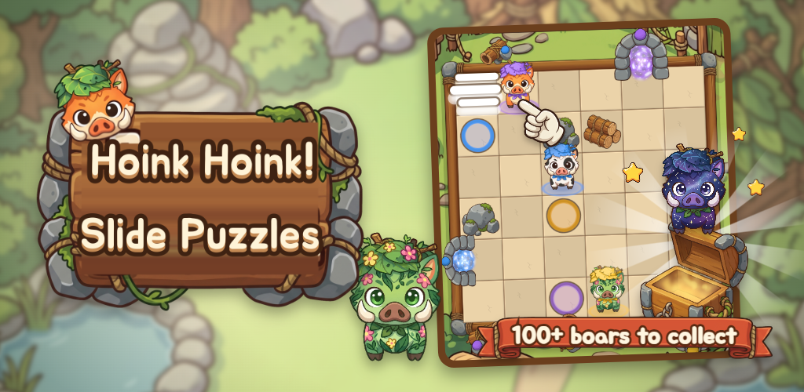

# Hoink Hoink! Slide Puzzles: closed test

[한국어](testers-ko.html) · [Home](./)

We're running an Android closed test before launch. Google Play requires new developer accounts to have **12 or more testers stay in the test for 14 days** before release, so your help means a lot!

## How to join (3 minutes)

1. **Join the Google Group**: [groups.google.com/g/hoink-testers](https://groups.google.com/g/hoink-testers) and click "Join group". Use the Gmail account you use on Google Play.
2. **Become a tester**: open the [opt-in link](https://play.google.com/apps/testing/com.go.hoinkhoinkslidepuzzles) and tap "Become a tester" (signed in with the same account).
3. **Install**: tap "Download it on Google Play" on the same page.
4. **Feedback**: after a few days of play, fill in the [3-minute form](https://forms.gle/BnFJXAbqFzRCoYsN6).

## Please

- **Keep the app installed and stay in the test for 14 days.** Leaving restarts the 14 days for your account.
- Opening the game for a minute or two a day helps a lot.
- We'll ship a few updates during the test; please update from Google Play.
- Progress is stored only on your device, and test progress may not carry over to the launch version.

## FAQ

- **iPhone?** Android only for now.
- **Does it cost anything?** No. You don't need to buy anything during the test.
- **What data do you use?** Your group email is used only for test notices, and the group is cleaned up after the test. See the [Privacy Policy](privacy.html).
- **Thanks**: if you like, we'll add your nickname to a thank-you page on this site after launch. Tell us in the form.

Contact: hoinkstudios@gmail.com